  
  
  
  

**Deep Bhattacharjee** (corresponding author, head of the project), Ushashi Bhattacharya.

| Proved | Open |
| :--- | :--- |
| The energy has exponent exactly 2Θ, with a limit | The critical bound Q(N) ≪ N^(1+ε) |
| Zero-one law: Q(N) > N^(2σ) for all large N when σ < Θ | Whether Q(N)/N is bounded |
| No set of x^(1/2+o(1)) primes moves the exponent; for every β > 1/2 some set of x^β primes raises it to at least 2β | The Riemann hypothesis |
| Q(N) > 2.81N infinitely often; Q(N)/N bounded exactly when L(x) ≪ √x | |
| Endpoint Nyman–Beurling theorem, with rate (log M)^(−1/4+o(1)) under RH; \|L(x)\| ≤ x/2641 + 8.3√x | |

| Folder | Contents | Run |
| :--- | :--- | :--- |
| [`LiouvilleEnergy/`](LiouvilleEnergy) | Lean 4 project over Mathlib | `lake exe cache get && lake build` |
| [`scripts/`](scripts) | axiom audit | `lake env lean scripts/Axioms.lean` |
| [`julia/`](julia) | identities, constants, certificates | `julia --project=julia julia/energy_checks.jl` |
